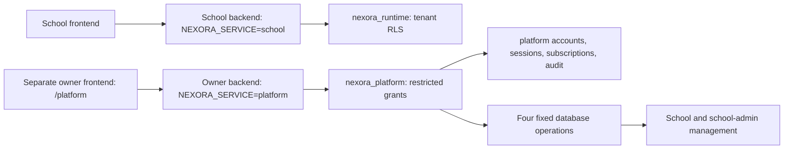

# Platform owner: architecture and testing guide

Production setup progress: [25 October owner deployment and enrollment](production-owner-setup-2026-10-25.md).

Current local status: see [24 October alignment and test results](local-release-readiness.md). Historical limitations below refer to the earlier run.

20 October 2026. Implemented locally on `feat/verified-platform-development`. No migration, owner account, cloud deployment or production setting has been changed by this implementation. Real database and deployment acceptance remains required.

## User-facing behavior

The owner signs in to `/platform` using a separate owner ID, password and confirmed authenticator. School administrators, teachers and students retain their existing identities and permissions.

- School directory: names, status, total student/teacher counts and subscription metadata, paginated 50 schools at a time.
- School provisioning: creates a school with a 30-day trial and its first inactive administrator. The generated administrator password is displayed once. Protected MFA enrollment must finish before administrator login.
- Additional administrators: creates another inactive administrator in the explicitly selected school, with the same protected enrollment requirement.
- Recovery: after verifying identity through the school's trusted support contact, reset a school administrator's password and revoke sessions. Optionally invalidate MFA and deactivate the administrator pending protected re-enrollment. Existing secrets/passwords are never revealed.
- Emergency suspension/reactivation: explicit impact acknowledgement, fresh owner MFA, reason and expected school revision. Suspension revokes school sessions and blocks subsequent authenticated online access, including exams. It cannot erase paper content already decrypted on an offline device. Reactivation does not restore revoked sessions.
- Subscriptions: manual `trial`, `active` or `restricted` state with optional expiry. Restricted/expired subscriptions stop new scheduling and rescheduling, not existing delivery, answer uploads, receipts or results. This is entitlement management; no payment processor, invoices or automatic charging is implemented.
- Health: database reachability and import/AI/package queue counts sampled on request, refreshed every minute while the portal is visible. Counts do not prove a worker is alive or establish capacity.
- Audits: platform operations, authentication events and directory/health/audit reads. Paginated 100 events at a time with explicit current-page JSON export. This does not expose every school's academic audit or student answers.

The portal is a management surface with scoped support actions. It does not impersonate school users, edit marks, access answer keys, run SQL, restore backups or provide an arbitrary school-data browser.

## Isolation and deployment topology

Use a separate owner frontend origin and separate owner backend deployment. Both reuse this repository, but receive different environment settings and credentials. A different URL path alone does not isolate browser origins.



`src/main.ts` chooses one Nest module. The platform deployment mounts only `PlatformModule`; it never loads school controllers into its Nest application. The ordinary deployment continues to mount `AppModule`. The platform database pool has no fallback to school or migration credentials.

Frontend `VITE_APP_SURFACE=platform` renders the owner portal for the entire owner frontend deployment. In the usual school build, `/platform` can also open the portal for local integration; production isolation should use the separate owner origin. The portal creates its own API client and query cache and never uses the school auth provider or demo accounts.

Production platform cookies are `__Host-nexora_platform`, HttpOnly, Secure, SameSite=Strict, Path=/ and have no Domain. Use a same-origin API rewrite on the owner frontend. An unrelated `vercel.app` API origin will not reliably receive Strict cookies. `docs/platform-owner.vercel.example.json` is a template, not an active deployment config; replace its backend hostname and apply it only to the owner frontend deployment. It proxies `/platform-api/v1/*` to the owner backend `/api/v1/*`.

| Deployment                  | Configuration                                                                                                                                                                                                                                                                      |
| --------------------------- | ---------------------------------------------------------------------------------------------------------------------------------------------------------------------------------------------------------------------------------------------------------------------------------- |
| School backend              | Existing restricted `DATABASE_URL`, school MFA/package keys; `NEXORA_SERVICE=school` or omitted. Do not add platform or migration credentials.                                                                                                                                     |
| Owner backend               | `NEXORA_SERVICE=platform`, `PLATFORM_DATABASE_URL` using exactly `nexora_platform`, separate `PLATFORM_MFA_ENCRYPTION_KEY`, `APP_ORIGIN` set to the exact owner frontend HTTPS origin. Existing verified TLS/CA pool options apply. Do not supply school or migration credentials. |
| Owner frontend              | `VITE_APP_SURFACE=platform`, `VITE_PLATFORM_API_BASE_URL=/platform-api/v1`, `PLATFORM_API_PROXY_TARGET` for the owner API, and `VITE_SCHOOL_PORTAL_ORIGIN` for school-admin enrollment links. The active `vercel.ts` provides the same-origin rewrite. No secret goes in a `VITE_` variable.                                                                                                                            |
| Protected operator terminal | `MIGRATION_DATABASE_URL`, separate platform key for owner enrollment, or school key for school-admin enrollment. Never deploy these privileged credentials to either web service.                                                                                                  |

Vercel remains the current target. Existing Nest configuration is reused in the separate backend project. No cron, long-running worker or new dependency is needed. HahuCloud remains a future hosting option. Deployment has not been rehearsed on Vercel for this feature.

## Database design

Migration `023_platform_owner.sql` adds a separate `platform` schema:

| Table           | Purpose                                                                                                                       |
| --------------- | ----------------------------------------------------------------------------------------------------------------------------- |
| `accounts`      | Operator-created owner identity, Argon2id hash, separately encrypted MFA secret, activation/enrollment and consumed TOTP step |
| `sessions`      | Hashed opaque tokens, CSRF, owner identity, authentication/expiry/revocation                                                  |
| `audit`         | Append-only application audit events with owner/school/action/reason/time and nonsecret details                               |
| `operations`    | Owner/request UUID, validated payload fingerprint and credential-free committed result                                        |
| `subscriptions` | School entitlement state, expiry and optimistic revision                                                                      |

All five tables force RLS. They do not rely on a school-user role enum. `nexora_runtime` cannot access owner identities, sessions, operations or audits. Its only platform-table grant is tenant-scoped subscription SELECT.

`nexora_platform` is a dedicated restricted login role with no superuser, RLS bypass, replication, object ownership, role memberships or schema-create privileges. Startup rejects an unsafe role. Production startup also rejects school/migration credentials in the owner service environment and requires verified database TLS. Its ordinary cross-school grants expose selected directory columns and job status columns only. It cannot read school password hashes, MFA secrets, exam content or answer tables. On owner accounts it can read and advance the consumed MFA step, but cannot create owners, change passwords or activate accounts.

Four fixed `SECURITY DEFINER` functions handle provisioning, additional administrator creation, school status and administrator reset. They have a fixed `pg_catalog` search path, no dynamic SQL, no PUBLIC execution and a separate no-login `nexora_platform_ops` owner. That role has explicit policies and column grants only for the required school/user/session operations; it has no RLS-bypass privilege. The web role is not a member of it. Reset predicates require both school and administrator IDs and restrict the role to `school_admin`.

Platform audit rows cannot be updated/deleted by the platform runtime. This is application-level append-only protection, not protection against a privileged database operator. Owner MFA encryption binds platform identity, account ID and secret version as authenticated data. School and owner encryption keys must remain separate.

## Authentication and transaction rules

- Bootstrap creates or reuses a short-lived CSRF session. Login validates exact Origin and CSRF, password, confirmed active owner and a fresh MFA step, then rotates both session and CSRF.
- Owner sessions expire after 30 minutes without sliding renewal. Every protected service method rechecks the database session and current owner while holding row locks. Operator recovery/deactivation revokes sessions; authentication predating enrollment is rejected too.
- Every mutation rechecks exact Origin/CSRF. Privileged actions consume a fresh MFA step; a code used at login or another action cannot be reused. A reused older step is also rejected.
- Anonymous bootstrap: 30 requests per observed IP per minute. Login: 20 per observed IP and 5 per login ID per five minutes. Privileged actions: 5 per owner per minute. Charges commit outside the sensitive transaction. Verify observed-IP behavior behind the deployed proxy; the service does not trust arbitrary forwarded IP headers.
- Successful action, business changes, audit and idempotency result commit together. Owner-row locking serializes duplicate operations for one owner. Identical replay returns the stored outcome with `credential: null`; a changed payload using the same key conflicts.
- School status/subscription changes require expected revisions. Subscription writes and scheduling use the same transaction advisory lock, including when no subscription row exists. Existing schools without a subscription row keep legacy scheduling access until explicitly configured.
- Passwords are generated randomly and stored as Argon2id hashes. Plaintext response credentials live only in component memory, clear on close/sign-out and automatically hide after one minute. Credentials and submitted codes never enter the query/mutation cache, browser storage, audit payload or idempotency record.
- Parsed failed login and privileged-action authentication/conflict outcomes are recorded without submitted secrets. Invalid bodies, early session failures and throttled requests are rejected; not every rejected HTTP request creates a platform audit row.

## API contract

The owner backend uses `/api/v1`. Its endpoints are independent of the school API at the same relative prefix in the school deployment.

| Method/path                 | Behavior                                                              |
| --------------------------- | --------------------------------------------------------------------- |
| GET `/auth/csrf`            | Anonymous CSRF bootstrap                                              |
| POST `/auth/login`          | `{loginId,password,code}`; returns display name and rotated CSRF      |
| GET `/auth/me`              | Current active owner display name                                     |
| POST `/auth/logout`         | Revoke current owner session                                          |
| GET `/schools?after=UUID`   | School directory and next cursor                                      |
| POST `/schools/:id/inspect` | `{reason}`; selected-school administrator directory and audit         |
| GET `/health`               | Bounded queue aggregate snapshot                                      |
| GET `/audit?before=ID`      | Latest/older platform audit page                                      |
| POST `/actions`             | Strict discriminated action body, reason, request UUID and fresh code |

Actions: `provision`, `create_admin`, `status`, `reset_admin`, `subscription`. Exact validated fields live in backend `src/platform/platform-schemas.ts` and frontend `src/features/platform/api.ts`. All responses use the existing private/no-store interceptor. No owner route is marked as a school public route; owner endpoints are mounted only in the platform module and call their own session/CSRF checks.

## First owner and administrator enrollment

Apply the reconciled migrations only on approved isolated staging first. Migration 023 has NOT been applied. This branch's historical 020 differs from the other development checkout's reported 020/021; reconcile the actual target ledger and definitions before any migration bundle is used. Do not overwrite old migrations. School scheduling now reads the subscription table, so deploy migration 023 before the new school backend.

Create a dedicated 32-byte random base64url platform MFA key in protected secret storage. In a private terminal, `node -e "console.log(require('node:crypto').randomBytes(32).toString('base64url'))"` generates the value; put it in the protected operator environment and owner-backend secret configuration as `PLATFORM_MFA_ENCRYPTION_KEY`. Do not paste that output into chat or source files. Provision the platform database login and first owner using a private interactive terminal from `nexora-backend`:

```text
npm run platform:operator -- provision-runtime
npm run platform:operator -- create
```

The operator requires protected migration credentials and interactive identity/reason verification. Runtime provisioning shows its new connection string only in the private terminal and refuses to rotate an existing login silently. Owner creation displays a generated password and enrollment URI in that private terminal, then requires a valid authenticator code within five minutes and five attempts. The account remains inactive on failure/interruption. Owner activation and its audit entry commit together.

```text
npm run platform:operator -- recover
npm run platform:operator -- disable
```

Recovery replaces owner credentials/MFA, immediately deactivates the owner and revokes sessions until confirmation. Disable revokes access and sessions. These commands are the break-glass recovery path, not public web APIs. They do not email secrets. Do not record terminal output in shared logs or send it into this chat.

School administrators created/reset through the portal still use the existing protected school MFA operator. After verified onboarding, use their returned school/admin IDs:

```text
npm run mfa:operator -- enroll --school-id <school-id> --staff-id <admin-id> --operator <identity> --reason "Verified school administrator enrollment"
```

Use the school MFA key for that command. Owner and school MFA secrets are different. Losing a one-time password response requires an explicit new password reset; replay does not regenerate or retrieve credentials. Close/reopen the portal action panel to intentionally start a new identical operation after a completed one.

## Backup changes

The backup CLI now includes both `public` and `platform` schemas and refuses a restore over either nonempty schema. Platform accounts, sessions, subscription state, audits and idempotency results are included. Keys and database roles remain external. Restore rehearsal must re-establish the restricted operation-function owner and revoke both school and owner sessions before activation. See `backup-and-restore.md`.

## Automated testing

Frontend: `npm run check` and `npm run build` from the repository root. Backend: `npm run build` and `npm run test:unit` from `nexora-backend`.

- Backend `test/unit/platform.spec.ts` tests separation from school cookies, protected-method denial, exact Origin/CSRF, disabled/re-enrolled owners, password/MFA login rotation, consumed codes, key separation, action confirmation, scoped reset calls, credential-free audits/replay and subscription scheduling behavior.
- Frontend `src/features/platform/PlatformApp.test.tsx` tests independent owner login, clearing submitted credentials, keeping an operation UUID after a lost response and truthful credential-free replay feedback.
- Existing school, runner, assistance and release tests are retained. Unit/component mocks do not execute PostgreSQL grants, functions, RLS or concurrent transactions.

Local verification on 20 October 2026:

- Frontend `npm run check`: passed type checking, lint, formatting, 204 unit/component tests and 9 release-source checks. An earlier run timed out finding the existing school-settings tab; that unchanged test passed in isolation and the complete suite then passed on rerun.
- Default school frontend production build: passed, with existing large-chunk and dependency-annotation warnings.
- Backend production build: passed; 143 unit tests passed, including 24 platform behavior tests and 6 platform configuration tests.
- Final lint and formatting checks after the configuration guards: passed.
- Owner-only production build (`VITE_APP_SURFACE=platform`): passed, with dependency-annotation warnings.
- PostgreSQL migration/function/RLS execution, Vercel deployment, real owner enrollment and cross-origin/two-device acceptance: not performed. No owner account or real school was created while testing this feature.

## Required real PostgreSQL and browser acceptance

1. Use a fresh disposable database and an isolated upgrade clone. Apply the reconciled chain through 023 with the protected migration role. Verify schema ownership, function ownership, ACLs, forced RLS and no PUBLIC function access. No test may use a production database.
2. As `nexora_runtime`, prove owner tables and operation functions are denied, and subscription reads are limited to the current school. As `nexora_platform`, prove school passwords/MFA secrets/answers are denied, owner creation/activation is denied, and audit update/delete is denied. Verify direct login as the no-login function owner fails.
3. Provision an owner through the protected terminal. Test rejected/expired enrollment, recovery, deactivation, old sessions, 30-minute expiry, wrong/used codes, limits and exact Origin/CSRF using real HTTP cookies.
4. Create two synthetic schools and administrators. Verify inactive-until-enrolled behavior, own-school school-admin permissions, scoped resets, session revocation and absence of all secret material from responses other than deliberate one-time credentials.
5. Race duplicate provisioning/reset, two owners editing a status/subscription revision, password reset against login and owner deactivation against an action. Confirm one committed idempotent outcome, rollback on failure and matching audit entries. Recheck authorization after any retry.
6. Simulate action commit followed by a lost response. Retry identical content/key: no duplicate account, no second password and no extra business mutation. A conflicting payload must fail.
7. Restrict/expire a subscription during an active exam. New scheduling/rescheduling fails; the active student's answer save, final snapshot, receipt and results paths remain unchanged. Existing-school legacy access also needs verification. Emergency suspension is tested separately and must revoke sessions.
8. Rehearse the separate Vercel frontend/backend pair, owner-origin rewrite and Strict cookie handling. A school-origin script must not be authorized to call the owner service. Verify TLS and platform-role startup checks, production mocks disabled and no secrets in frontend assets.
9. Check 360px layout, keyboard access, visible-tab refresh, logout/expiry credential clearing, stale/error states, pagination and explicit current-page audit export on real browsers. Exercise backup/restore including owner records and separately retained keys.

Record commit, schema ledger, database roles, origins, device/browser versions, outcomes and failures. Keep deployment approval separate from local implementation completion.
